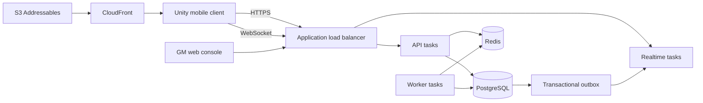

# System architecture

## Runtime topology

The API, realtime gateway, and worker are separate processes from one modular codebase. PostgreSQL commits authoritative state and outbox events in the same transaction. Realtime tasks fan committed events to connected clients through Redis.

## Server modules

- Identity: guest accounts, account linking, sessions, bans, and device revocation.
- Player/city: profile, resources, buildings, queues, research, troops, hospital, and inventory.
- World: viewport snapshots, map occupancy, spawning, teleports, and march lifecycle.
- Combat: deterministic battle simulation, casualties, loot, and reports.
- Alliance/social: membership, roles, help, rallies, chat, mail, blocks, and moderation.
- Live operations: events, leaderboards, feature flags, rewards, announcements, and compensation.
- Commerce: catalog, receipt validation, grants, refunds, and economy ledger entries.
- Platform: configuration, database, Redis, idempotency, outbox, telemetry, and health.

Modules may call another module through an application interface, not its tables. Database transactions can span modules only for one player command; asynchronous side effects use the outbox.

## Authority and consistency

- Commands lock or version affected rows and validate again inside the transaction.
- Each command carries an idempotency key. Replays return the original status and response.
- Resource deductions, queue creation, ledger entry, and outbox publication commit atomically.
- Timers store `finish_at` in PostgreSQL. Workers use database time and claim rows with `FOR UPDATE SKIP LOCKED`.
- Map positions have a unique kingdom/coordinate constraint.
- Leaderboards and viewport caches may lag, but command validation reads authoritative rows.
- Combat takes a server-selected seed and integer inputs; report replay must produce identical output.

## Failure behavior

- Redis unavailable: reject rate-sensitive commands only when required; continue authoritative database operations and rebuild cache after recovery.
- Worker restart: another worker reclaims expired leases and processes overdue jobs.
- Realtime disconnect: client reconnects with its last sequence; gateway replays retained events or instructs it to bootstrap.
- Duplicate mobile request: idempotency record returns the committed response without applying the command twice.
- Partial deployment: expand/migrate/contract schema changes preserve compatibility with the previous image.

## Observability

Every request and job carries a correlation ID and OpenTelemetry trace. Structured logs include player, kingdom, command, and error code without tokens or sensitive purchase payloads. Required metrics cover request latency, database pool saturation, due-job lag, battle duration, WebSocket connections, outbox lag, login failures, economy deltas, and purchase outcomes.
