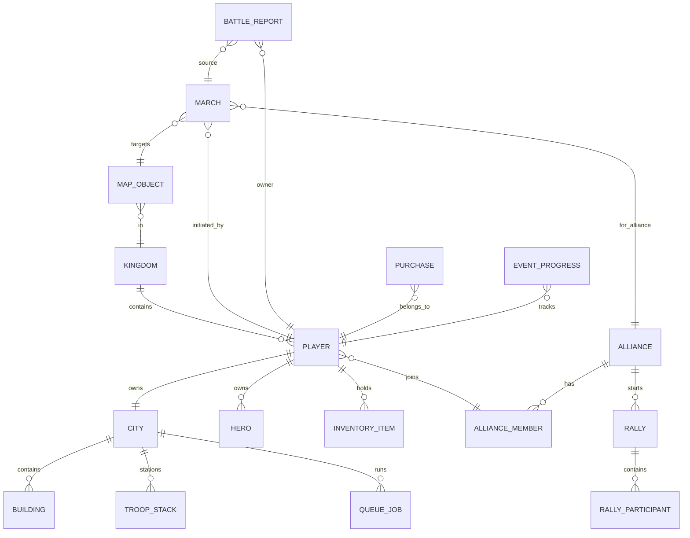
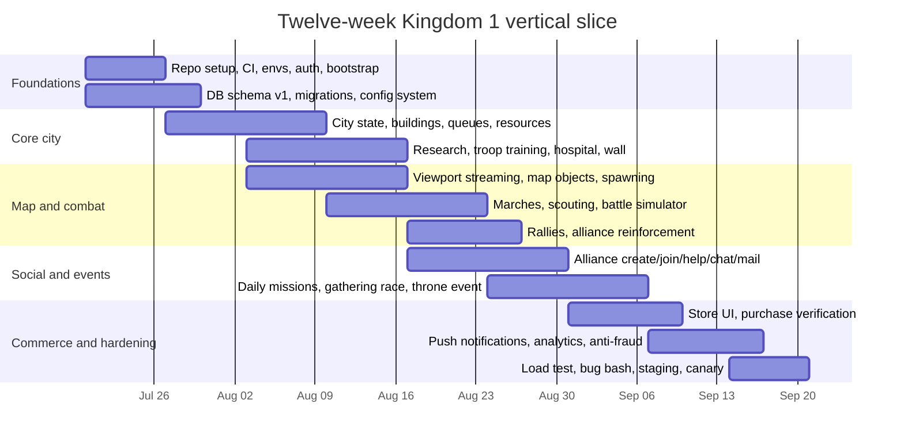

> Imported from the user-supplied blueprint for traceability. Broken internal citation tokens were removed. All figures, formulas, schedules, and balance tables are design assumptions; the maintained documents under `docs/product` and `docs/engineering` are authoritative.

# Single Kingdom 4X MMO Blueprint Inspired by Publicly Observable Clash of Kings Systems

## Executive summary

A small team can build a **single-kingdom, persistent mobile 4X strategy MMO** for iOS and Android that captures the *genre pattern* publicly observable in **Clash of Kings** and similar titles: city building, resource production, armies, alliance warfare, real-time marches, rallies, monsters, throne events, leaderboards, timers, boosts, and live-ops. Public store descriptions for *Clash of Kings* explicitly advertise walls, resource production, armies, heroes, technology, alliances, and competitive events such as Throne War and Kingdom Conquest, while public update logs and community pages describe systems like rallying, random teleports, scout marks, Battle for the Throne shield restrictions, and alliance-focused structures such as the Hall of War.

I cannot help produce a **near-exact clone** of another company’s game or reconstruct proprietary internals as though you had permission. Apple’s App Review Guidelines say apps must include only content the developer created or licensed and must avoid protected third-party material and “copycat representations,” while Google Play’s Intellectual Property policy prohibits infringement and says developers must ensure all app and store-listing content is original or properly licensed. So the plan below is deliberately framed as a **lawful, original implementation blueprint inspired by public genre conventions and public-facing observable behaviors**, not a one-to-one copy of proprietary content, balance tables, assets, or confidential server logic.

For a launch limited to **Kingdom 1**, the best architecture is **server-authoritative** from day one: one logical kingdom shard, a world map streamed by viewport, all timers and battle outcomes resolved on the server, purchases verified on the backend, and all data tagged with `kingdom_id` so future kingdoms can be enabled without schema rewrites. From a product perspective, this lines up with how mobile 4X games work: Google Play’s genre report defines 4X strategy as combining real-time strategy, world-building, and RPG mechanics, with players fighting PvP, building armies, and defending bases, and it emphasizes that top 4X titles win by improving onboarding, retention, and monetization rather than by shallow re-skins.

For an initial two-developer effort, the realistic target is a **vertical slice** in about **12 weeks** and a broader **MVP** in about **20–24 weeks**, assuming 5k–20k registered users and 1k–3k active users in Kingdom 1, as a planning assumption rather than an observed market forecast. The shortest successful path is to ship: one city; one kingdom; four core resources; four troop classes; one rally system; one alliance stack; monsters; throne event; purchases; chat; reports; push notifications; and a modest live-ops cadence. The sections below specify the feature set, data models, APIs, formulas, UI flows, infrastructure, security controls, testing plan, roadmap, and Codex-oriented implementation package in detail.

## Product definition and feature inventory

### Publicly observable reference baseline

The public App Store description for *Clash of Kings* describes a familiar high-end mobile 4X formula: city strengthening, resource production, army training, heroes, technology, alliances, real-time wars, and major recurring event pillars like Throne War, Kingdom Conquest, Dragon Campaign, Empire Domination, and Battle of the Firmament. Public update logs additionally show map monsters, gathering event currencies, random teleport rules, chat/friend optimizations, peace shield restrictions during throne competition, scout-mark tooling, and rally/reinforcement improvements around the palace. Community pages document a Hall of War that exists to gather allied troops for coordinated attacks and increases rally capacity by level.

Public 4X analyses are useful for deciding **what to keep** and **what to simplify**. Google Play’s 4X genre report says the genre centers on conquering “digital real-estate” on a server, defending territory in PvP, and managing long-session progression with heavy time and resource investment; it also notes that leading 4X titles improved KPIs by broadening support for more player types and by sharpening onboarding and monetization. A long-form Game Developer analysis similarly describes the genre baseline that later titles converged on: one city with deeper progression, a world map, visible marches, useful PvE, resource gathering, research depth, heroes, and equipment.

### Recommended original feature set for Kingdom 1

The table below is the **recommended lawful feature inventory** for an original single-kingdom launch. The “public inspiration” column points to publicly visible genre evidence; the implementation choices are original.

| System | Launch scope for Kingdom 1 | Public inspiration | Original implementation note |
|---|---|---|---|
| City core | One city per player | Public city-building/store descriptions | Keep one city only; avoid multi-city complexity at launch |
| Buildings | 16–20 buildings | Public building/community pages, city depth analyses | Use original names/art/stats |
| Resources | Food, Wood, Iron, Silver, Gold premium | Store descriptions + 4X norms | Gold is premium only; no hidden fifth gatherable at launch |
| Research | Economy, Military, Defense, Monster, Alliance aid | Public “technological secrets” + deeper research trees in 4X analyses | Four trees at launch, not ten |
| Troops | Infantry, Cavalry, Archers, Siege | Store descriptions explicitly name troop families | Ten tiers maximum in data model, unlock only T1–T8 at launch |
| Heroes | 3 active heroes, 12 collectible heroes total | Public heroes mention + 4X analysis of hero/equipment depth | Original skill trees |
| Equipment | 6 slots, rarity tiers | Public equipment references in updates/analysis | Original stats and crafting inputs |
| Hospital | Wounded capacity and heal queue | Public updates mention hospital prestige and healing changes | One base hospital plus alliance medical aid buff |
| Walls | Durability, traps, burning state | Public store description mentions strong walls | Burning imposes output penalty until repaired |
| VIP | 25 VIP levels | Common F2P 4X pattern + public IAP-heavy genre analysis | Favor convenience, not total exclusivity |
| Alliance | Join/apply, roles, help, tech, gifts, rallies | Public alliances, Hall of War, battle/throne updates | Five default roles |
| Chat | World, kingdom, alliance, private, system | Public chat/friend optimizations in updates | World chat rate-limited and progressively unlocked |
| Mail | System, battle, alliance, player | Public mail/report optimizations in updates | Mail retention policy after 30–90 days |
| World map | 1200×1200 grid, streamed by viewport | World-map baseline in 4X analysis | Single shard: Kingdom 1 only |
| Map tiles | empty, city, node, monster, alliance structure, throne ring | Public map monsters/gathering/throne features | Data-driven tile registry |
| Marches | attack, scout, gather, reinforce, occupy, rally join | Public visible marches/scout marks/rallies | March slots increase with research/VIP |
| Shields | beginner shield, purchased shields, war restrictions | Public updates mention throne participants can’t use peace shields | Auto-break on hostile action except scouting rules you define |
| Relocation | beginner teleport, random teleport, precise teleport | Public teleport rule changes in updates | Validate region occupancy server-side |
| Throne event | Weekly palace/throne contest | Public Throne War/Battle for the Throne | One weekly event for Kingdom 1 |
| Capitals/catapults | Palace center + 4 control points | Public updates reference palace and catapults | Catapults provide ring bonuses |
| Monsters | map monsters, elite guardians | Public kingdom-map monster events and guardian rallies | Original monster roster |
| Purchases | starter packs, speedups, resource packs, monthly card | 4X monetization guidance + public IAP store presence | Verify on server only |
| Events | daily missions, 3-day race, gathering event, kill event, throne war | Public event culture in store page and update history | Placeholder “cross-kingdom soon” surface only |
| Leaderboards | power, kill score, city level, alliance power, throne contributions | Public leaderboards mention on App Store listing | Recompute hourly with Redis + Postgres snapshots |

### Building stack

A practical Kingdom 1 launch stack is below. Every building here exists because it either unlocks a major loop or supports a monetization/retention mechanic.

| Building | Primary function | Dependencies | Notes |
|---|---|---|---|
| Palace | Global city level gate | none | Controls max building level |
| Farm | Food production | Palace | 2 copies allowed |
| Lumberyard | Wood production | Palace | 2 copies allowed |
| Iron Mine | Iron production | Palace 9 | 1–2 copies |
| Silver Mine | Silver production | Palace 15 | 1 copy |
| Barracks | Infantry training | Palace | One per city |
| Stable | Cavalry training | Palace | One per city |
| Range | Archer training | Palace | One per city |
| Workshop | Siege training | Palace | One per city |
| Academy | Research | Palace 4 | Core progression unlock |
| Hospital | Wounded recovery | Palace 4 | Capacity + heal speed |
| Wall | Defense durability | Palace | Enables trap substats |
| Embassy | Reinforcement cap/help count | Palace 6 | Needed for alliance defense flows |
| Hall of War | Rally capacity | Embassy 2 | Inspired by public Hall of War role; implementation original |
| Drill Grounds | March size | Palace 3 | March slot cap tied to level |
| Warehouse | Protected resources | Palace | Loot mitigation |
| Watchtower | Scout defense, alerting | Palace 7 | Shows incoming march fidelity |
| Forge | Equipment craft/refine | Palace 8 | Six-slot equipment loop |
| Tavern | Hero recruit/fragments | Palace 5 | Daily free summon |
| Market | Resource trade/help logistics | Palace 10 | Internal exchange and alliance donations |

## Server architecture, data model, and network contracts

### Core architecture

For Kingdom 1, the best-fit production architecture is a **server-authoritative backend** with: an HTTPS API for commands and snapshots; WebSockets for real-time map, chat, and event updates; PostgreSQL as the source of truth; Redis for caches, rate limits, queues, temporary state, and sorted-set leaderboards; worker processes for timers and march arrival resolution; and stateless API pods behind a load balancer. PostgreSQL partitioning is especially helpful for large append-heavy tables like battle reports, map events, chat messages, and analytics exports, while `jsonb` plus GIN indexes let you keep some flexible combat-detail or reward payloads queryable without turning the whole schema into EAV.

A useful operational split is:

- **API service**: auth, profile, city, build/research/train commands
- **Map service**: viewport streaming, coordinate locks, object queries, march dispatch
- **Battle service**: deterministic simulation and report generation
- **Alliance service**: membership, roles, help, tech, gifts, rally state
- **Economy service**: resources, item consumption, rewards, sinks/sources audit
- **Commerce service**: Apple/Google purchase verification, entitlements
- **Realtime gateway**: WebSockets, fanout, presence, channel auth
- **Worker fleet**: timers, retries, heal/build/train completions, scheduled events
- **Ops service**: event config, GM tools, moderation, mail, compensation

Redis is well suited for hot ephemeral state and fanout-adjacent structures, while Prometheus and OpenTelemetry are a clean observability baseline for metrics, traces, and alerting. Prometheus is widely used for cloud-native monitoring, and OpenTelemetry standardizes capture of metrics and distributed traces across services.

### Entity model



### Relational schema

The schema below is the minimum you need to avoid painting yourself into a corner.

| Table | Key columns | Notes |
|---|---|---|
| `kingdoms` | `id`, `code`, `status`, `map_size`, `opened_at` | Only `K1` active; `K2+` marked hidden/coming soon |
| `players` | `id`, `kingdom_id`, `account_id`, `name`, `power`, `vip_level`, `gold`, `state_jsonb` | Player-level progression and flags |
| `cities` | `id`, `player_id`, `kingdom_id`, `x`, `y`, `palace_level`, `shield_until`, `burn_until` | One active city per player at launch |
| `buildings` | `id`, `city_id`, `slot_key`, `building_type`, `level`, `prestige_level`, `state_jsonb` | Intentional support for future prestige |
| `troop_stacks` | `id`, `city_id`, `troop_type`, `tier`, `count`, `wounded_count` | Stationed troops snapshot |
| `research_levels` | `player_id`, `research_key`, `level` | PK `(player_id, research_key)` |
| `heroes` | `id`, `player_id`, `hero_key`, `level`, `star`, `skills_jsonb`, `equipment_jsonb` | Keep hero build flexible |
| `alliances` | `id`, `kingdom_id`, `tag`, `name`, `power`, `banner_jsonb`, `language` | Single-kingdom scope |
| `alliance_members` | `alliance_id`, `player_id`, `role`, `joined_at`, `contribution` | PK `(alliance_id, player_id)` |
| `marches` | `id`, `kingdom_id`, `player_id`, `march_type`, `origin_x`, `origin_y`, `target_type`, `target_id`, `depart_at`, `arrive_at`, `payload_jsonb`, `status` | Hot operational table |
| `rallies` | `id`, `kingdom_id`, `alliance_id`, `leader_player_id`, `target_type`, `target_id`, `launch_at`, `status`, `payload_jsonb` | Rally pre-launch bundle |
| `queue_jobs` | `id`, `city_id`, `job_type`, `ref_type`, `ref_id`, `start_at`, `finish_at`, `status`, `cost_jsonb` | Build/research/train/heal |
| `map_objects` | `id`, `kingdom_id`, `object_type`, `x`, `y`, `level`, `owner_alliance_id`, `state_jsonb`, `respawn_at` | Resource nodes, monsters, throne, etc. |
| `battle_reports` | `id`, `kingdom_id`, `owner_player_id`, `source_march_id`, `report_type`, `summary_jsonb`, `details_jsonb`, `created_at` | Partition monthly |
| `mails` | `id`, `owner_player_id`, `mail_type`, `title`, `body_jsonb`, `attachments_jsonb`, `read_at`, `expires_at` | Structured rewards |
| `purchases` | `id`, `player_id`, `platform`, `sku`, `platform_txn_id`, `purchase_token`, `state`, `verified_at`, `payload_jsonb` | Idempotency anchor |
| `event_definitions` | `id`, `kingdom_scope`, `event_type`, `config_jsonb`, `starts_at`, `ends_at` | Admin-authored |
| `event_progress` | `event_id`, `player_id`, `score`, `claimed_jsonb`, `rank_snapshot_jsonb` | Partition by event |
| `audit_economy_ledger` | `id`, `player_id`, `change_type`, `resource_key`, `delta`, `reason`, `ref_type`, `ref_id`, `created_at` | Non-optional for debugging |
| `chat_messages` | `id`, `channel_type`, `channel_id`, `sender_player_id`, `body`, `created_at`, `moderation_state` | Usually in partitioned table |

### API design principles

The contract should be **command/query separated**. Commands mutate state and return either a state delta or an accepted-job envelope. Queries return snapshots or viewport slices. Every mutating call must support **idempotency**, either via `Idempotency-Key` header or an explicit `client_op_id`, because mobile networks retry aggressively.

Representative REST surface:

| Method | Path | Purpose | Auth | Idempotent |
|---|---|---|---|---|
| `POST` | `/v1/auth/guest` | Guest bootstrap | none | yes |
| `POST` | `/v1/auth/link` | Link Apple/Google account | bearer | yes |
| `GET` | `/v1/bootstrap` | Initial full-state snapshot | bearer | no |
| `GET` | `/v1/city` | City overview | bearer | no |
| `POST` | `/v1/city/build/start` | Start building upgrade | bearer | yes |
| `POST` | `/v1/city/build/speedup` | Use speedups on build job | bearer | yes |
| `POST` | `/v1/city/research/start` | Start research | bearer | yes |
| `POST` | `/v1/city/train/start` | Start troop training | bearer | yes |
| `POST` | `/v1/city/heal/start` | Start healing wounded | bearer | yes |
| `POST` | `/v1/items/use` | Use shield/teleport/speedup/item | bearer | yes |
| `GET` | `/v1/map/viewport` | Stream visible tiles by bounds | bearer | no |
| `GET` | `/v1/map/object/{id}` | Inspect node/monster/city/throne | bearer | no |
| `POST` | `/v1/map/march/dispatch` | Dispatch attack/scout/gather/reinforce | bearer | yes |
| `POST` | `/v1/map/rally/create` | Create rally | bearer | yes |
| `POST` | `/v1/map/rally/join` | Join rally | bearer | yes |
| `POST` | `/v1/city/teleport` | Random/precise/beginner teleport | bearer | yes |
| `POST` | `/v1/alliance/create` | Create alliance | bearer | yes |
| `POST` | `/v1/alliance/apply` | Apply to alliance | bearer | yes |
| `POST` | `/v1/alliance/help` | Help ally timer | bearer | yes |
| `POST` | `/v1/alliance/tech/donate` | Donate alliance tech currency | bearer | yes |
| `GET` | `/v1/mail` | Mailbox page | bearer | no |
| `POST` | `/v1/mail/{id}/claim` | Claim mail attachment | bearer | yes |
| `GET` | `/v1/reports/battles` | Battle reports list | bearer | no |
| `POST` | `/v1/commerce/verify` | Submit store purchase for verification | bearer | yes |
| `GET` | `/v1/store/catalog` | IAP catalog | bearer | no |
| `GET` | `/v1/events/active` | Active events | bearer | no |
| `GET` | `/v1/leaderboards/{key}` | Ranking snapshot | bearer | no |

WebSocket channels:

| Channel | Events |
|---|---|
| `player:{id}` | job_completed, resource_delta, mail_new, purchase_state, event_reward |
| `city:{city_id}` | city_under_attack, reinforcement_arrived, wall_burning |
| `alliance:{id}` | help_requested, rally_created, member_joined, tech_donated |
| `map:kingdom:{id}:viewport:{hash}` | tile_changed, march_spawned, object_respawned |
| `chat:{scope}` | chat_message, moderation_notice |
| `event:{id}` | phase_change, scoreboard_update, throne_state |

### Request and response examples

**Bootstrap**

```http
GET /v1/bootstrap
Authorization: Bearer <jwt>
```

```json
{
  "serverTime": "2026-07-20T13:30:00Z",
  "kingdom": {
    "id": "K1",
    "displayName": "Kingdom 1",
    "status": "OPEN",
    "futureKingdomsState": "COMING_SOON"
  },
  "player": {
    "id": "p_123",
    "name": "LordAsh",
    "power": 184220,
    "vipLevel": 4,
    "gold": 1220
  },
  "city": {
    "id": "c_123",
    "x": 418,
    "y": 227,
    "palaceLevel": 12,
    "shieldUntil": "2026-07-20T18:30:00Z",
    "resources": {
      "food": 128230,
      "wood": 116900,
      "iron": 20340,
      "silver": 1840
    }
  },
  "queues": [
    {
      "id": "q_build_9",
      "jobType": "BUILD",
      "refType": "BUILDING",
      "refId": "b_wall",
      "finishAt": "2026-07-20T16:05:00Z"
    }
  ],
  "activeEvents": ["daily_missions", "gathering_race", "throne_war_countdown"]
}
```

**Start a building upgrade**

```http
POST /v1/city/build/start
Idempotency-Key: 1f8baca0-7e3b-4d80-8f9f-44cf0b93a66f
Authorization: Bearer <jwt>
Content-Type: application/json
```

```json
{
  "buildingId": "b_hospital",
  "targetLevel": 8,
  "useFreeQueue": true
}
```

```json
{
  "accepted": true,
  "job": {
    "id": "q_build_77",
    "jobType": "BUILD",
    "buildingId": "b_hospital",
    "fromLevel": 7,
    "toLevel": 8,
    "startedAt": "2026-07-20T13:35:00Z",
    "finishAt": "2026-07-20T16:11:00Z"
  },
  "costPaid": {
    "food": 9200,
    "wood": 9200,
    "iron": 1300,
    "silver": 0
  },
  "cityDelta": {
    "resources": {
      "food": -9200,
      "wood": -9200,
      "iron": -1300
    }
  }
}
```

**Dispatch a march**

```http
POST /v1/map/march/dispatch
Idempotency-Key: march-20260720-001
Authorization: Bearer <jwt>
Content-Type: application/json
```

```json
{
  "marchType": "ATTACK",
  "originCityId": "c_123",
  "target": {
    "targetType": "CITY",
    "targetId": "c_998",
    "x": 427,
    "y": 233
  },
  "formation": "FRONT_TO_BACK",
  "heroIds": ["h_1", "h_9"],
  "troops": [
    { "troopType": "INFANTRY", "tier": 6, "count": 14000 },
    { "troopType": "CAVALRY", "tier": 6, "count": 6000 },
    { "troopType": "ARCHER", "tier": 5, "count": 12000 },
    { "troopType": "SIEGE", "tier": 4, "count": 3000 }
  ]
}
```

```json
{
  "accepted": true,
  "march": {
    "id": "m_88442",
    "status": "EN_ROUTE",
    "departAt": "2026-07-20T13:40:00Z",
    "arriveAt": "2026-07-20T13:46:32Z",
    "distance": 10.82,
    "secondsToTarget": 392
  },
  "troopsReserved": 35000
}
```

**Create a rally**

```json
POST /v1/map/rally/create
{
  "targetType": "MONSTER",
  "targetId": "mo_guardian_18",
  "stagingSeconds": 300,
  "heroIds": ["h_1"],
  "leadTroops": [
    { "troopType": "INFANTRY", "tier": 6, "count": 8000 },
    { "troopType": "ARCHER", "tier": 6, "count": 12000 }
  ]
}
```

```json
{
  "accepted": true,
  "rally": {
    "id": "r_882",
    "launchAt": "2026-07-20T13:50:00Z",
    "currentCapacity": 220000,
    "currentCommitted": 20000,
    "allianceBroadcastSent": true
  }
}
```

**Purchase verification**

```json
POST /v1/commerce/verify
{
  "platform": "GOOGLE_PLAY",
  "sku": "pack.starter.01",
  "purchaseToken": "abcdef...",
  "orderId": "GPA.1234-5678-9012-34567"
}
```

```json
{
  "accepted": true,
  "purchase": {
    "id": "buy_10022",
    "state": "PENDING_VERIFICATION"
  }
}
```

### Authoritative simulation rules

The client must send **intent**, never **outcome**. That means:

- the client says “start build,” never “my hospital is now level 8”
- the client says “dispatch these troops to this target,” never “I won the battle”
- the client says “claim this store transaction,” never “grant 9,999 gold”
- the client says “use teleport here,” never “my city is now at x,y”

This is not cosmetic. It is the boundary that prevents timer forgery, modified battle results, spoofed resource gains, altered march speed, and fake purchases. Research on online-game cheating consistently classifies client manipulation, timing abuse, identity spoofing, and state forgery as recurrent attack types, while server-side verification remains a foundational defense.

## Gameplay systems, formulas, and progression tables

### Systems design

For Kingdom 1, the cleanest launch loop is:

1. **Produce** resources in city and by gathering.
2. **Upgrade** buildings and research.
3. **Train** troops and heroes.
4. **Hunt** monsters for items and event currencies.
5. **Join** an alliance for help, gifts, reinforcement, and rallies.
6. **Fight** for map position, resource control, and the throne.
7. **Return** through timed jobs, notifications, and rotating events.

That loop is genre-consistent with both Google’s 4X framing and public analyses of successful mobile 4X titles, while still leaving room for original combat math and original content progression.

### Proposed original battle formulas

The formulas below are **proposed original values**, not claimed reconstructions of any proprietary title.

#### Troop base stats

Each troop instance has:

- `attack`
- `defense`
- `health`
- `speed`
- `load`
- `counter_tags`
- `tier_power`

Recommended unit classes:

| Class | Battlefield role | Base trait |
|---|---|---|
| Infantry | frontline, soak | high defense, high health |
| Cavalry | flank, pursuit | high speed, anti-archer |
| Archers | backline DPS | high attack, fragile |
| Siege | wall/resource damage | low speed, high structure damage |

#### Effective stat pipeline

For troop stack `S`:

```text
effectiveAttack =
  baseAttack
  * (1 + hero_attack_bonus + research_attack_bonus + building_attack_bonus + alliance_attack_bonus)
  * formation_attack_mult
  * terrain_attack_mult
  * random(0.97, 1.03)

effectiveDefense =
  baseDefense
  * (1 + hero_defense_bonus + research_defense_bonus + building_defense_bonus + alliance_defense_bonus)
  * formation_defense_mult
  * terrain_defense_mult

effectiveHealth =
  baseHealth
  * (1 + hero_health_bonus + research_health_bonus + building_health_bonus + alliance_health_bonus)
```

#### Counter multiplier

Use a simple class-counter matrix:

| Attacker \ Defender | Infantry | Cavalry | Archers | Siege |
|---|---:|---:|---:|---:|
| Infantry | 1.00 | 0.90 | 1.10 | 1.10 |
| Cavalry | 1.10 | 1.00 | 1.25 | 1.15 |
| Archers | 1.20 | 0.85 | 1.00 | 1.10 |
| Siege | 0.80 | 0.75 | 0.90 | 1.00 |

#### Round damage

Per round, for attacking stack `A` against defending stack `D`:

```text
rawDamage =
  A.count
  * A.effectiveAttack
  * counterMultiplier(A.class, D.class)
  * skillProcMultiplier
  * moraleMultiplier

mitigatedDamage =
  rawDamage
  * (100 / (100 + D.effectiveDefense))

hpDamage = mitigatedDamage
casualties = floor(hpDamage / D.effectiveHealth)
```

#### Morale

Morale starts at `100` for both armies.

- `+3` if attacker total march power > defender by 20%
- `+2` if formation counters target formation
- `-5` if army contains >40% siege against city defense
- `-8` if wall is burning and defender has no reinforcements
- min `80`, max `120`

```text
moraleMultiplier = morale / 100
```

#### Wounded versus dead

For city defense battles:

```text
woundedCap = hospitalCapacity - currentWounded
defenderWounded = min(casualties * woundedRate, woundedCap)
defenderDead = casualties - defenderWounded
```

Suggested wounded rates:

- defender city battle: `0.70`
- alliance-reinforcing defender: `0.60`
- open-field battle: `0.25`
- monster battle: `0.85`
- throne fight zone: `0.45`

If hospital is full, overflow becomes dead.

#### Loot calculation

```text
protectedFood  = warehouseProtectedFood
protectedWood  = warehouseProtectedWood
protectedIron  = warehouseProtectedIron
protectedSilver = warehouseProtectedSilver

availableLoot(resource) =
  max(0, cityStored(resource) - protected(resource))

lootCap =
  sum(eachTroop.load * survivingTroopCount)
  * raidBonusMultiplier

actualLoot =
  proportionalSplit(availableLoot, lootCap)
```

#### March speed and arrival

```text
marchSpeed =
  slowestTroopSpeed
  * (1 + hero_speed_bonus + research_speed_bonus + vip_speed_bonus + item_speed_bonus)

travelSeconds =
  ceil((distanceTiles * tileDistanceSeconds) / marchSpeed)
```

Suggested tile distance base:

- open terrain: `30` sec/tile
- mountain/swamp rings near throne: `36` sec/tile
- beginner zone roads: `24` sec/tile

#### Rally resolution

A rally stores a canonical manifest at launch time:

```text
rallyArmy = concat(leaderTroops, participantTroops)
rallyLeaderBonuses = leaderHero + leaderResearch + allianceBonuses
participantBonuses = restricted to army-local stats unless flagged global
```

To keep calculations legible at launch, use:

- leader hero skills apply globally
- participant hero passive stats apply only to participant troops
- alliance tech applies globally
- maximum five participants at launch
- rally staging windows: 5m, 10m, 30m
- monster rallies allow 2m quick-rally if alliance tech unlocked

### Progression tables

All tables below are **proposed original values** for a lawful original design.

#### Palace upgrade curve example

| Lvl | Food | Wood | Iron | Silver | Time |
|---:|---:|---:|---:|---:|---:|
| 1 | 600 | 600 | 0 | 0 | 5m |
| 2 | 810 | 810 | 0 | 0 | 7m |
| 3 | 1,094 | 1,094 | 0 | 0 | 10m |
| 4 | 1,476 | 1,476 | 0 | 0 | 15m |
| 5 | 1,993 | 1,993 | 0 | 0 | 22m |
| 6 | 2,690 | 2,690 | 0 | 0 | 32m |
| 7 | 3,632 | 3,632 | 0 | 0 | 46m |
| 8 | 4,903 | 4,903 | 0 | 0 | 1h 7m |
| 9 | 6,619 | 6,619 | 0 | 0 | 1h 37m |
| 10 | 8,936 | 8,936 | 300 | 0 | 2h 21m |
| 11 | 12,064 | 12,064 | 399 | 0 | 3h 25m |
| 12 | 16,286 | 16,286 | 531 | 0 | 4h 57m |
| 13 | 21,987 | 21,987 | 706 | 0 | 7h 11m |
| 14 | 29,682 | 29,682 | 939 | 0 | 10h 26m |
| 15 | 40,070 | 40,070 | 1,248 | 0 | 15h 8m |
| 16 | 54,095 | 54,095 | 1,660 | 200 | 21h 56m |
| 17 | 73,028 | 73,028 | 2,208 | 260 | 1d 7h |
| 18 | 98,588 | 98,588 | 2,937 | 338 | 1d 22h |
| 19 | 133,094 | 133,094 | 3,906 | 439 | 2d 18h |
| 20 | 179,677 | 179,677 | 5,196 | 571 | 4d 1h |
| 21 | 242,564 | 242,564 | 6,910 | 743 | 5d 20h |
| 22 | 327,462 | 327,462 | 9,191 | 965 | 8d 11h |
| 23 | 442,073 | 442,073 | 12,223 | 1,255 | 12d 7h |
| 24 | 596,799 | 596,799 | 16,257 | 1,631 | 17d 20h |
| 25 | 805,678 | 805,678 | 21,622 | 2,121 | 25d 21h |

#### Military research curve example

Example research: **Infantry Attack**

| Level | Cumulative bonus | Food | Wood | Iron | Silver | Time |
|---:|---:|---:|---:|---:|---:|---:|
| 1 | +0.5% | 400 | 400 | 0 | 0 | 3m |
| 2 | +1.0% | 528 | 528 | 0 | 0 | 4m |
| 3 | +1.5% | 697 | 697 | 0 | 0 | 5m |
| 4 | +2.0% | 920 | 920 | 0 | 0 | 7m |
| 5 | +2.5% | 1,214 | 1,214 | 0 | 0 | 10m |
| 6 | +3.0% | 1,602 | 1,602 | 0 | 0 | 14m |
| 7 | +3.5% | 2,114 | 2,114 | 0 | 0 | 20m |
| 8 | +4.0% | 2,790 | 2,790 | 200 | 0 | 27m |
| 9 | +4.5% | 3,683 | 3,683 | 256 | 0 | 37m |
| 10 | +5.0% | 4,861 | 4,861 | 328 | 0 | 51m |
| 11 | +5.5% | 6,416 | 6,416 | 419 | 0 | 1h 10m |
| 12 | +6.0% | 8,469 | 8,469 | 536 | 0 | 1h 37m |
| 13 | +6.5% | 11,179 | 11,179 | 687 | 0 | 2h 14m |
| 14 | +7.0% | 14,756 | 14,756 | 879 | 120 | 3h 6m |
| 15 | +7.5% | 19,478 | 19,478 | 1,125 | 150 | 4h 17m |
| 16 | +8.0% | 25,711 | 25,711 | 1,440 | 188 | 5h 54m |
| 17 | +8.5% | 33,939 | 33,939 | 1,844 | 234 | 8h 9m |
| 18 | +9.0% | 44,800 | 44,800 | 2,360 | 293 | 11h 15m |
| 19 | +9.5% | 59,136 | 59,136 | 3,021 | 366 | 15h 31m |
| 20 | +10.0% | 78,060 | 78,060 | 3,867 | 458 | 21h 25m |
| 21 | +10.5% | 103,166 | 103,166 | 4,952 | 572 | 1d 7h |
| 22 | +11.0% | 136,180 | 136,180 | 6,338 | 715 | 1d 19h |
| 23 | +11.5% | 179,757 | 179,757 | 8,113 | 894 | 2d 11h |
| 24 | +12.0% | 237,280 | 237,280 | 10,385 | 1,118 | 3d 10h |
| 25 | +12.5% | 313,209 | 313,209 | 13,292 | 1,397 | 4d 17h |

#### Troop training table

Values shown **per 100 troops**.

| Tier | Power each | Atk | Def | HP | Food/100 | Wood/100 | Iron/100 | Silver/100 | Train time/100 |
|---|---:|---:|---:|---:|---:|---:|---:|---:|---:|
| T1 | 2 | 5 | 6 | 20 | 5,000 | 4,000 | 0 | 0 | 25m |
| T2 | 4 | 9 | 10 | 32 | 10,000 | 8,000 | 0 | 0 | 50m |
| T3 | 6 | 13 | 14 | 44 | 20,000 | 16,000 | 0 | 0 | 1h 40m |
| T4 | 8 | 17 | 18 | 56 | 40,000 | 32,000 | 3,000 | 0 | 3h 20m |
| T5 | 10 | 21 | 22 | 68 | 80,000 | 64,000 | 6,000 | 0 | 6h 40m |
| T6 | 12 | 25 | 26 | 80 | 160,000 | 128,000 | 12,000 | 0 | 13h 20m |
| T7 | 14 | 29 | 30 | 92 | 320,000 | 256,000 | 24,000 | 2,000 | 1d 2h |
| T8 | 16 | 33 | 34 | 104 | 640,000 | 512,000 | 48,000 | 4,000 | 2d 5h |
| T9 | 18 | 37 | 38 | 116 | 1,280,000 | 1,024,000 | 96,000 | 8,000 | 4d 10h |
| T10 | 20 | 41 | 42 | 128 | 2,560,000 | 2,048,000 | 192,000 | 16,000 | 8d 21h |

#### VIP progression example

| VIP | XP to reach next | Total XP at level | Core perk |
|---:|---:|---:|---|
| 1 | 100 | 0 | none |
| 2 | 155 | 100 | +1 help queue |
| 3 | 240 | 255 | +2% build speed |
| 4 | 372 | 495 | +1 march preset |
| 5 | 577 | 867 | +3% research speed |
| 6 | 894 | 1,444 | +1 daily hero summon |
| 7 | 1,386 | 2,338 | +3% training speed |
| 8 | 2,148 | 3,724 | +1 extra builder for 2h/day |
| 9 | 3,329 | 5,872 | +5% gathering speed |
| 10 | 5,160 | 9,201 | +1 permanent march slot |
| 11 | 7,998 | 14,361 | +5% hospital heal speed |
| 12 | 12,397 | 22,359 | +5% alliance help effect |
| 13 | 19,215 | 34,756 | +5% monster damage |
| 14 | 29,783 | 53,971 | +1 rally preset |
| 15 | 46,164 | 83,754 | +5% march speed |
| 16 | 71,554 | 129,918 | +5% wall repair speed |
| 17 | 110,909 | 201,472 | +10% daily pack claim value |
| 18 | 171,909 | 312,381 | +2nd free teleport/week |
| 19 | 266,459 | 484,290 | +2% all combat stats |
| 20 | 413,335 | 750,749 | +1 permanent skill loadout |
| 21 | 640,669 | 1,164,084 | +5% all resource output |
| 22 | 993,038 | 1,804,753 | +1 extra march preset page |
| 23 | 1,539,208 | 2,797,791 | +3% rally capacity |
| 24 | 2,385,773 | 4,336,999 | +3% all troop health |
| 25 | — | 6,723,359 | cosmetic frame + premium QoL bundle |

#### Event reward curve example

Example event: **Gathering Race** over 3 days.

| Milestone points | Reward |
|---:|---|
| 5,000 | 5m speedups × 5 |
| 15,000 | Food bundle L2 × 3 |
| 35,000 | Wood bundle L2 × 3 |
| 60,000 | Iron bundle L2 × 2 |
| 90,000 | Hero XP × 10,000 |
| 130,000 | 1h speedup × 5 |
| 180,000 | Shield 8h × 1 |
| 250,000 | Rare hero fragments × 10 |
| 340,000 | Gold × 500 |
| 450,000 | Event chest epic × 1 |

### Shield, teleport, and beginner rules

A sound Kingdom 1 launch ruleset is:

- New accounts receive **72h beginner shield**
- Shield breaks on `ATTACK`, `RALLY_CREATE`, `RALLY_JOIN`, `SCOUT` if target is player city, or manual cancel
- Gathering a neutral node does **not** break shield
- Rallying a monster does **not** break shield
- Throne event zones disallow shield activation after entry
- Beginner teleport usable until Palace 6 or account age 7 days, whichever comes first
- Random teleport consumes item and searches free tile weighted toward low-density zones
- Precise teleport requires vacant tile and min distance from throne ring unless alliance territory owned

The throne-related shield restriction is consistent with publicly visible *Clash of Kings* update behavior, but the exact implementation above is original and simplified for launch.

### World map and spawn rules

Use a **1200 × 1200** square grid, Kingdom 1 only. Practical zoning:

- outer ring: low-level beginner/resource zones
- mid ring: alliance expansion and higher-tier nodes
- inner ring: throne region and catapult control points
- neutral object slots seeded at map generation
- fixed throne at center, four catapults on diagonals, alliance forts in ring corridors

Spawn algorithm:

```text
1. Pick a candidate zone from beginner-eligible clusters.
2. Reject coordinates within minimum exclusion radius of cities, throne ring, or blocked objects.
3. Score remaining cells by density, recent spawns, and alliance clustering.
4. Atomically reserve chosen tile in DB transaction.
5. Seed 6 nearby nodes: 2 food, 2 wood, 1 iron, 1 monster.
6. Apply beginner shield and protected relocation flag.
```

Viewport streaming query:

```http
GET /v1/map/viewport?minX=400&maxX=440&minY=210&maxY=250&sinceVersion=33499
```

Response:

```json
{
  "version": 33514,
  "tiles": [
    { "x": 418, "y": 227, "kind": "PLAYER_CITY", "refId": "c_123", "level": 12, "shielded": true },
    { "x": 423, "y": 229, "kind": "RESOURCE_NODE", "resource": "WOOD", "level": 5, "amount": 180000 },
    { "x": 427, "y": 233, "kind": "PLAYER_CITY", "refId": "c_998", "level": 13, "shielded": false }
  ],
  "patches": [
    { "op": "UPSERT", "tileKey": "427:233" },
    { "op": "DELETE", "tileKey": "425:230" }
  ]
}
```

## Client architecture, UI flows, and content pipeline

### Unity client structure

Unity is still a sensible cross-platform choice for this kind of game because it supports iOS and Android deployment, Addressables supports remote content delivery through a CDN, and Unity’s Localization package provides locale and string/asset table workflows. For runtime analytics and push-notification integration, Firebase Analytics and FCM are both widely used and documented for Unity-supported mobile stacks.

Recommended project tree:

```text
Assets/
  _Game/
    Boot/
      Bootstrapper.cs
      ServiceRegistry.cs
    Config/
      GameConfig.asset
      RemoteConfigKeys.cs
    Networking/
      ApiClient.cs
      RealtimeSocket.cs
      Dto/
    Domain/
      Player/
      City/
      Battle/
      Alliance/
      Events/
      Commerce/
    UI/
      Screens/
        Login/
        KingdomEntry/
        City/
        BuildingDetails/
        Research/
        Troops/
        Heroes/
        Equipment/
        WorldMap/
        MarchPanel/
        RallyPanel/
        Alliance/
        Chat/
        Mail/
        Store/
        Events/
        Leaderboards/
        Throne/
      Components/
      Popups/
      ViewModels/
    Addressables/
      Labels.asset
    Localization/
      StringTables/
      AssetTables/
    Art/
      UI/
      City/
      Map/
      FX/
    Audio/
      Music/
      SFX/
    Analytics/
      AnalyticsEvents.cs
    Tests/
      EditMode/
      PlayMode/
```

### Scene flow

Keep scenes minimal:

| Scene | Purpose |
|---|---|
| `Boot` | SDK init, version check, config load, account restore |
| `Login` | guest/start/link account |
| `KingdomEntry` | splash, “Kingdom 1 open / others coming soon” |
| `Main` | additive shell scene hosting city and overlay UIs |
| `WorldMap` | additive streamed map scene |
| `BattleReplay` | lightweight playback scene |
| `Loading` | interstitial only if needed for low-memory devices |

The main city and map should preferably live under one shell so switching between them is a camera/state transition rather than a full hard scene reload. That keeps memory stable and reduces hitching on older devices.

### UI flows

#### First-time user flow

```text
Boot -> Guest Login -> Intro Choices -> City Tutorial -> Build Farm ->
Collect Quest Reward -> Train Infantry -> Open World Map ->
Join/Apply Alliance -> Hunt First Monster -> Return to City ->
Prompt Starter Pack -> Continue Daily Missions
```

#### Returning user flow

```text
Boot -> Restore Session -> Bootstrap Snapshot ->
If active throne phase then show event toast ->
If completed jobs then show completion inbox ->
Open city or map depending on last state
```

#### Major screens

| Screen | Key panels | Critical actions |
|---|---|---|
| City | resource bar, building hotzones, queue bar, quest ribbon | collect, upgrade, speedup |
| Building details | level, prerequisites, costs, bonuses, queue button | upgrade/cancel/speedup |
| Troops | tabs by troop class, train slider, tier selector | start training |
| Research | tree tabs, research nodes, bonus preview | start/speedup research |
| Hero roster | hero cards, sort/filter, equipment slots | equip/level/assign |
| Equipment | inventory, forge recipe, rarity tabs | craft/refine/equip |
| World map | tile viewport, object drawer, march panel | scout/attack/gather/reinforce |
| Rally panel | rally list, join UI, countdown | create/join/cancel |
| Alliance | members, help, tech, gifts, territory, mail | donate/help/manage roles |
| Chat | channel tabs, emoji, quick translate, report | send/report/mute |
| Mail | system/battle/alliance/player tabs | read/claim/delete |
| Store | packs, daily deals, monthly card, gold shop | purchase |
| Events | active cards, rules, milestones, ranking tabs | claim rewards |
| Throne | phase banner, timers, occupancy, reward summary | navigate/send march |
| Leaderboards | tabs, filters, personal rank | inspect player/alliance |

### Wireframe-style JSON

Example for **city HUD**:

```json
{
  "screen": "CityHUD",
  "layout": {
    "topBar": ["avatar", "power", "vipBadge", "resources", "gold", "settings"],
    "leftRail": ["quests", "events", "mail", "offers"],
    "bottomBar": ["city", "map", "alliance", "heroes", "bag", "store"],
    "center": ["buildingHotspots", "queueBanner", "npcGuideBubble"],
    "rightRail": ["buffs", "notifications", "chatPreview"]
  },
  "bindings": {
    "resources.food": "player.city.resources.food",
    "queueBanner.items": "player.city.activeQueues",
    "buffs.items": "player.activeBuffs"
  },
  "states": {
    "cityNormal": {
      "queueBanner.visible": true,
      "npcGuideBubble.visible": false
    },
    "tutorialBuildFarm": {
      "dimAll": true,
      "highlight": "buildingHotspots.farm_1",
      "npcGuideBubble.visible": true
    },
    "cityUnderAttack": {
      "screenShake": true,
      "alertBanner": "Incoming Attack!"
    }
  }
}
```

Example **screen-state transitions**:

```json
{
  "from": "WorldMap",
  "event": "tileTapped.playerCity",
  "guards": ["target.visible", "notInMarchComposition"],
  "actions": ["openContextDrawer", "prefetchScoutPreview"],
  "to": "WorldMapContext"
}
```

```json
{
  "from": "StoreScreen",
  "event": "purchase.verified",
  "actions": ["playRewardFx", "refreshPlayerGold", "showItemsGrantedPopup"],
  "to": "StoreScreen"
}
```

### Content and asset pipeline

Addressables should be used for remote art, event banners, hero portraits, map object prefabs, and seasonal UI. Unity’s documentation recommends remote catalogs and CDN-hosted groups for remote distribution, and `DownloadDependenciesAsync` is suitable for prefetching labeled bundles before an event starts. Localization should use string tables for all UI copy, rules text, and event text; asset tables should cover region-specific images later, even if launch is English only.

Recommended labels:

- `ui.core`
- `ui.events`
- `map.common`
- `map.monsters`
- `heroes.portraits`
- `audio.music.core`
- `audio.sfx.core`
- `season.s1`
- `locale.en-US`

### Analytics hooks

Firebase Analytics supports up to 500 event types with parameters, which is enough for a deep live-service game if you standardize names early.

Minimum analytics taxonomy:

| Event name | Key params |
|---|---|
| `tutorial_step_complete` | `step_id`, `seconds_since_install` |
| `build_started` | `building`, `from_level`, `to_level` |
| `build_completed` | `building`, `to_level`, `used_speedup` |
| `troops_trained` | `troop_type`, `tier`, `count` |
| `research_started` | `research_key`, `to_level` |
| `march_dispatched` | `march_type`, `target_type`, `distance` |
| `battle_resolved` | `result`, `report_type`, `loss_ratio` |
| `alliance_joined` | `alliance_size`, `days_since_install` |
| `event_reward_claimed` | `event_id`, `milestone` |
| `iap_started` | `sku`, `price_tier` |
| `iap_verified` | `sku`, `platform`, `first_purchase` |
| `shield_activated` | `duration_hours`, `source` |
| `teleport_used` | `teleport_type`, `zone_band` |

## Live operations, commerce, security, and quality

### Live-ops design

Google’s 4X report is especially useful here. It notes that leading 4X titles improved performance by reducing onboarding friction, improving retention, and clarifying monetization, and it specifically points to better starter packs and clearer value propositions in week-one conversion improvements. Public *Clash of Kings* update history also shows how often map events, gathering events, monster events, and seasonal currencies are used to keep the world active.

Recommended Kingdom 1 live-ops cadence:

| Cadence | Event | Core objective |
|---|---|---|
| Daily | Daily missions | habit loop and resource sink/source balance |
| Daily | Monster hunt burst | map activity and alliance coordination |
| Every 3 days | Gathering Race | boosts map density and gathering contention |
| Weekly | Power Sprint | build/train/research burn |
| Weekly | Kill Event | PvP spike and shield drain |
| Weekly | Throne War | alliance climax and kingdom narrative |
| Monthly | Season pass track | retention and monetization spine |
| Placeholder | Cross-Kingdom preview tile | “Coming Soon” only, no gameplay |

### Store and IAP catalog

Apple StoreKit and Google Play Billing both support one-time digital purchases; Google’s billing documentation recommends using backend acknowledgement/verification flows for better reliability and entitlement safety, and Apple recommends using the App Store Server API and signed transaction information for server-side validation.

Suggested launch catalog:

| SKU | Type | Example grant | Notes |
|---|---|---|---|
| `pack.starter.01` | one-time | gold, speedups, hero fragments, shield | shown first 48h |
| `pack.growth.05` | one-time | construction speedups, resources | appears at Palace milestones |
| `pack.war.01` | one-time | teleports, boosts, heals | war-prep pack |
| `gold.499` | consumable | 500 gold | base currency |
| `gold.2499` | consumable | 2,700 gold | bonus tier |
| `gold.9999` | consumable | 11,500 gold | best value |
| `card.monthly` | subscription/card-like entitlement | daily gold + QoL perks | implement as renewable if supported regionally |
| `pass.season.s1` | entitlement | unlock premium reward track | season-scoped |
| `pack.throne.defense` | one-time | shields, heals, buffs | throne event surfaced |

### Purchase verification flow

#### Apple

Apple’s StoreKit stack automatically verifies signed transaction information on device, and the App Store Server API is designed for retrieving Apple-signed transaction and subscription information from your backend.

Recommended flow:

1. Client starts StoreKit purchase.
2. Client obtains verified transaction locally.
3. Client posts `transactionId` and signed payload to backend.
4. Backend calls App Store Server API if needed.
5. Backend verifies app bundle, transaction state, revocation/refund status.
6. Backend grants entitlement inside DB transaction.
7. Backend records idempotency against `platform_txn_id`.
8. Backend sends `purchase_granted` WS event and mail attachment.

#### Google Play

Google Play Billing provides app + backend APIs, and Google’s documentation recommends using the secure backend to acknowledge subscriptions and to retrieve purchase details through the Developer API and RTDN lifecycle notifications.

Recommended flow:

1. Client completes Billing Library purchase.
2. Client sends `purchaseToken` + `orderId` + `sku`.
3. Backend calls `purchases.products.get`.
4. Backend validates `purchaseState`, `acknowledgementState`, `productId`, package name, order ID.
5. Backend grants entitlement once.
6. Backend acknowledges purchase from backend when applicable.
7. RTDN updates trigger refund/revocation cleanup.
8. Audit entry written to economy ledger.

### Push notifications

FCM is a cross-platform messaging layer for reliable message delivery and can carry notification or data payloads; APNs is Apple’s notification delivery channel for iOS devices. FCM guidance also explicitly recommends building message requests in a trusted server environment, which fits the MMO requirement that the backend remains the source of truth for timer completions and alerting.

Push categories:

- build complete
- training complete
- research complete
- hospital full
- alliance rally started
- city under attack
- throne phase started
- shield expiring soon
- season ending soon
- purchase acknowledged

### Security and anti-cheat

The anti-cheat posture should be layered and pragmatic. Cheating research shows recurring classes of attacks: client-state manipulation, timing abuse, masquerade/identity abuse, collusion, and network-level exploits; more recent work also shows the limits of purely client-side anti-cheat in the face of man-at-the-end attacks. That makes server authority, server-side verification, anomaly detection, and strong commerce integrity far more important than trying to “trust” the handset.

Recommended controls:

| Layer | Control |
|---|---|
| Account | guest throttling, device fingerprint hash, cooldown on mass re-registration |
| Transport | TLS, JWT short-lived access tokens, rotating refresh tokens |
| Command auth | every mutating call requires player/session/kingdom match |
| Idempotency | mandatory for purchases, march dispatch, item use, queue starts |
| Server authority | client sends intent only |
| Economy | append-only economy ledger with anomaly alarms |
| Movement/combat | recompute legal travel time and target reachability on server |
| Chat/social | rate limits, muted words, moderation actions |
| Purchases | server verification only |
| Device integrity Android | Play Integrity verdicts for risky flows | 
| Device integrity iOS | App Attest / DeviceCheck for sensitive actions |
| Fraud heuristics | impossible speedups, repeated refund-abuse, synchronized alt-account farming |
| OpSec | secret rotation, least-privileged service accounts, isolated commerce keys |

Google’s Play Integrity API returns device, app, and account integrity information that your server can interpret, and Apple’s DeviceCheck/App Attest stack is explicitly intended to help apps assert validity before receiving access to sensitive resources.

### Backups, monitoring, deployment, and rollback

Deployment should use **staging → canary → full rollout** with fast rollback and strict schema discipline.

Recommended baseline:

| Concern | Recommendation |
|---|---|
| DB backups | nightly full + 15 min WAL/archive point-in-time recovery |
| Redis | persistence for noncritical queues only; rebuildable hot state |
| Deploy | blue/green or canary with traffic shifting |
| Metrics | Prometheus scrape + Alertmanager |
| Traces | OpenTelemetry everywhere |
| Logs | structured JSON with correlation IDs |
| Rollback | previous image + backward-compatible migrations only |
| Chaos drills | fail worker pod, DB replica failover, Redis eviction test |
| SLOs | API p95 < 250ms, map viewport p95 < 400ms, march resolution lag < 5s |

Prometheus and OpenTelemetry are well-suited for this exact kind of service fleet.

### Testing plan

Suggested quality gates:

| Test layer | What to test |
|---|---|
| Unit | combat math, loot split, hospital overflow, shield break rules |
| Property-based | no negative resources, no duplicate grants, no illegal teleport placements |
| Integration | API + DB transaction boundaries, purchase verification, RTDN/App Store notifications |
| Contract | JSON schema validation between client and server |
| Soak | 24h timer churn and event scheduling |
| Load | 1,000 simulated peak concurrent players for Kingdom 1 MVP |
| Abuse | double-submit purchases, replayed Idempotency-Key, altered march payloads |
| Playtest | tutorial completion, first-attack comprehension, alliance onboarding |

Representative load targets for the stated planning assumption:

- 300–700 CCU normal
- 1,000 concurrent during throne phase spike
- 50 map viewport requests/sec sustained
- 100 chat msgs/sec burst
- 30 battle resolutions/sec spike
- 10 purchase verifications/minute peak launch sale burst

## Roadmap and Codex-oriented implementation package

### Development roadmap

A realistic split for two developers is:

- **Vertical slice, 12 weeks**: city, map, marches, monsters, alliance basics, purchases stub, one event, one throne flow
- **Broader MVP, 20–24 weeks**: heroes, equipment, deeper alliance tech, store polish, leaderboards, moderation, seasonal pass, production hardening

#### Twelve-week Gantt



#### Sprint-by-sprint output

| Sprint | Server milestones | Client milestones | QA focus |
|---|---|---|---|
| 1 | auth, bootstrap, schema v1 | login, boot, city shell | smoke, schema |
| 2 | building queue, resource tick | city HUD, build panel | queue correctness |
| 3 | research, troop training | research and troop screens | resource sink balance |
| 4 | map viewport, objects | map camera, tile rendering | viewport sync |
| 5 | marches, scouting, reports | march composition, reports UI | battle correctness |
| 6 | alliances, chat, help | alliance UI, chat | moderation/rate limits |
| 7 | rallies, reinforce, monsters | rally panel, monster targets | rally edge cases |
| 8 | throne event, palace occupancy | throne UI, event cards | phase transitions |
| 9 | commerce backend, catalog | store UI, reward popups | purchase verification |
| 10 | push, leaderboards, analytics | hooks and notifications | telemetry completeness |
| 11 | soak/load, bug bash | bug fixing | resilience |
| 12 | staging, canary, submit builds | release candidate | rollback drills |

### Codex usage guidance

OpenAI’s current Codex materials emphasize that Codex can work on codebase tasks in parallel, that the CLI and app are built for agentic software workflows, and that prompting tends to work better when instructions are **lean, scoped, and backed by repo-local skills and documentation** rather than bloated master prompts. OpenAI’s prompt guidance also recommends straightforward instructions, clear desired formats, and concise task constraints.

A good repository layout for Codex:

```text
/docs
  architecture.md
  api_contracts.md
  combat_math.md
  economy_rules.md
  ux_states.md
/.codex
  SKILL_city-systems.md
  SKILL_map-and-battle.md
  SKILL_commerce.md
  SKILL_unity-ui.md
```

#### Exact prompt templates for Codex

**Prompt for API scaffolding**

```text
Read /docs/api_contracts.md and /docs/architecture.md.

Implement the Go HTTP handlers and PostgreSQL repository layer for:
- GET /v1/bootstrap
- POST /v1/city/build/start
- POST /v1/map/march/dispatch

Constraints:
- Server-authoritative only
- All mutating endpoints require idempotency support
- Use transactions for resource deduction + queue creation
- Return JSON exactly matching docs/api_contracts.md
- Add table-driven unit tests
- Do not add frameworks beyond stdlib + pgx + chi
- If a contract is ambiguous, add a TODO and preserve backward compatibility

Output:
- changed files
- migration files
- tests
- short notes on any assumptions
```

**Prompt for battle simulator**

```text
Read /docs/combat_math.md.

Implement a deterministic battle simulator in Go.
Requirements:
- No floating nondeterminism in report output
- Seeded randomness passed explicitly
- Support ATTACK_CITY, SCOUT_CITY, ATTACK_MONSTER, THRONE_BATTLE
- Produce both summary and detailed per-round battle report JSON
- Add golden tests for 12 scenarios
- Add fuzz tests for “no negative casualties” and “no NaN values”

Do not touch networking or database code.
```

**Prompt for map service**

```text
Read /docs/architecture.md and /docs/api_contracts.md.

Implement the map viewport read path and march dispatch command path.
Requirements:
- Viewport supports minX/maxX/minY/maxY and sinceVersion patching
- March dispatch validates origin ownership, troop availability, target legality, distance, shield rules, and march slots
- Use Redis only for hot cache and coordinate locks; Postgres remains source of truth
- Add integration tests for duplicate dispatch retries using the same Idempotency-Key
```

**Prompt for Unity city UI**

```text
Read /docs/ux_states.md and /docs/api_contracts.md.

Implement the CityHUD, BuildingDetailsPanel, and QueueBanner in Unity C#.
Requirements:
- MVVM-friendly structure
- No hardcoded strings
- Bind all text through Localization tables
- All art references must resolve through Addressables labels
- Use placeholder sprites and data if needed
- Include play mode tests for screen state transitions
```

**Prompt for commerce**

```text
Read /docs/architecture.md and /docs/api_contracts.md.

Implement purchase verification pipelines for Apple and Google.
Requirements:
- Client never grants content locally
- Server records purchases idempotently
- Grant entitlements exactly once
- Support refund/revocation update hooks
- Add unit tests for duplicate notifications and replayed tokens
- Add economy ledger entries for every grant and revoke
```

### Server stub examples

#### Go march-dispatch handler

```go
package march

import (
	"context"
	"encoding/json"
	"net/http"
	"time"
)

type DispatchRequest struct {
	MarchType string `json:"marchType"`
	OriginCityID string `json:"originCityId"`
	Target struct {
		TargetType string `json:"targetType"`
		TargetID   string `json:"targetId"`
		X          int    `json:"x"`
		Y          int    `json:"y"`
	} `json:"target"`
	Formation string `json:"formation"`
	HeroIDs   []string `json:"heroIds"`
	Troops    []struct {
		TroopType string `json:"troopType"`
		Tier      int    `json:"tier"`
		Count     int    `json:"count"`
	} `json:"troops"`
}

type DispatchResponse struct {
	Accepted bool `json:"accepted"`
	March struct {
		ID              string `json:"id"`
		Status          string `json:"status"`
		DepartAt        string `json:"departAt"`
		ArriveAt        string `json:"arriveAt"`
		Distance        float64 `json:"distance"`
		SecondsToTarget int `json:"secondsToTarget"`
	} `json:"march"`
	TroopsReserved int `json:"troopsReserved"`
}

type Service interface {
	DispatchMarch(ctx context.Context, playerID string, req DispatchRequest, idempotencyKey string) (*DispatchResponse, error)
}

type Handler struct {
	Svc Service
}

func (h *Handler) Dispatch(w http.ResponseWriter, r *http.Request) {
	ctx := r.Context()
	playerID := r.Header.Get("X-Player-ID")
	idempotencyKey := r.Header.Get("Idempotency-Key")
	if playerID == "" || idempotencyKey == "" {
		http.Error(w, "missing auth or idempotency key", http.StatusBadRequest)
		return
	}

	var req DispatchRequest
	if err := json.NewDecoder(r.Body).Decode(&req); err != nil {
		http.Error(w, "invalid json", http.StatusBadRequest)
		return
	}

	resp, err := h.Svc.DispatchMarch(ctx, playerID, req, idempotencyKey)
	if err != nil {
		// Map domain errors to HTTP codes in production.
		http.Error(w, err.Error(), http.StatusUnprocessableEntity)
		return
	}

	w.Header().Set("Content-Type", "application/json")
	_ = json.NewEncoder(w).Encode(resp)
}

// Example domain-side helper showing deterministic timing.
func ComputeArrival(now time.Time, distance float64, speed float64) time.Time {
	seconds := int(distance * 30.0 / speed)
	if seconds < 1 {
		seconds = 1
	}
	return now.Add(time.Duration(seconds) * time.Second)
}
```

#### TypeScript economy ledger stub

```ts
export type EconomyReason =
  | "BUILD_START"
  | "RESEARCH_START"
  | "TRAIN_START"
  | "HEAL_START"
  | "PURCHASE_GRANT"
  | "EVENT_REWARD";

export interface EconomyEntry {
  playerId: string;
  resourceKey: "food" | "wood" | "iron" | "silver" | "gold";
  delta: number;
  reason: EconomyReason;
  refType: string;
  refId: string;
  createdAt: string;
}

export interface EconomyLedgerRepo {
  append(entries: EconomyEntry[]): Promise<void>;
}

export class EconomyLedgerService {
  constructor(private readonly repo: EconomyLedgerRepo) {}

  async recordBuildStart(playerId: string, refId: string, cost: Record<string, number>) {
    const now = new Date().toISOString();
    const entries: EconomyEntry[] = Object.entries(cost)
      .filter(([, value]) => value > 0)
      .map(([resourceKey, value]) => ({
        playerId,
        resourceKey: resourceKey as EconomyEntry["resourceKey"],
        delta: -value,
        reason: "BUILD_START",
        refType: "QUEUE_JOB",
        refId,
        createdAt: now,
      }));

    if (entries.length > 0) {
      await this.repo.append(entries);
    }
  }
}
```

### Unity C# client stub

```csharp
using System;
using System.Net.Http;
using System.Text;
using System.Threading.Tasks;
using UnityEngine;

[Serializable]
public class BuildStartRequest {
    public string buildingId;
    public int targetLevel;
    public bool useFreeQueue;
}

[Serializable]
public class BuildStartResponse {
    public bool accepted;
    public BuildJob job;
}

[Serializable]
public class BuildJob {
    public string id;
    public string jobType;
    public string buildingId;
    public int fromLevel;
    public int toLevel;
    public string startedAt;
    public string finishAt;
}

public sealed class ApiClient : IDisposable {
    private readonly HttpClient _http;

    public ApiClient(string baseUrl, string bearerToken) {
        _http = new HttpClient { BaseAddress = new Uri(baseUrl) };
        _http.DefaultRequestHeaders.Authorization =
            new System.Net.Http.Headers.AuthenticationHeaderValue("Bearer", bearerToken);
    }

    public async Task<BuildStartResponse> StartBuildAsync(BuildStartRequest req, string idempotencyKey) {
        var json = JsonUtility.ToJson(req);
        var message = new HttpRequestMessage(HttpMethod.Post, "/v1/city/build/start") {
            Content = new StringContent(json, Encoding.UTF8, "application/json")
        };
        message.Headers.Add("Idempotency-Key", idempotencyKey);

        using var response = await _http.SendAsync(message);
        response.EnsureSuccessStatusCode();

        var body = await response.Content.ReadAsStringAsync();
        return JsonUtility.FromJson<BuildStartResponse>(body);
    }

    public void Dispose() => _http.Dispose();
}
```

### SQL migration example

```sql
CREATE TABLE kingdoms (
    id              text PRIMARY KEY,
    code            text NOT NULL UNIQUE,
    status          text NOT NULL,
    map_size        integer NOT NULL,
    opened_at       timestamptz NOT NULL DEFAULT now()
);

CREATE TABLE players (
    id              text PRIMARY KEY,
    kingdom_id      text NOT NULL REFERENCES kingdoms(id),
    account_id      text NOT NULL,
    name            text NOT NULL,
    power           bigint NOT NULL DEFAULT 0,
    vip_level       integer NOT NULL DEFAULT 1,
    gold            bigint NOT NULL DEFAULT 0,
    state_jsonb     jsonb NOT NULL DEFAULT '{}'::jsonb,
    created_at      timestamptz NOT NULL DEFAULT now()
);

CREATE TABLE cities (
    id              text PRIMARY KEY,
    player_id       text NOT NULL UNIQUE REFERENCES players(id),
    kingdom_id      text NOT NULL REFERENCES kingdoms(id),
    x               integer NOT NULL,
    y               integer NOT NULL,
    palace_level    integer NOT NULL DEFAULT 1,
    shield_until    timestamptz,
    burn_until      timestamptz,
    created_at      timestamptz NOT NULL DEFAULT now(),
    UNIQUE (kingdom_id, x, y)
);

CREATE TABLE queue_jobs (
    id              text PRIMARY KEY,
    city_id         text NOT NULL REFERENCES cities(id),
    job_type        text NOT NULL,
    ref_type        text NOT NULL,
    ref_id          text NOT NULL,
    start_at        timestamptz NOT NULL,
    finish_at       timestamptz NOT NULL,
    status          text NOT NULL,
    cost_jsonb      jsonb NOT NULL DEFAULT '{}'::jsonb
);

CREATE INDEX idx_queue_jobs_city_status_finish
ON queue_jobs(city_id, status, finish_at);

CREATE TABLE purchases (
    id                  text PRIMARY KEY,
    player_id           text NOT NULL REFERENCES players(id),
    platform            text NOT NULL,
    sku                 text NOT NULL,
    platform_txn_id     text,
    purchase_token      text,
    state               text NOT NULL,
    payload_jsonb       jsonb NOT NULL DEFAULT '{}'::jsonb,
    verified_at         timestamptz
);

CREATE UNIQUE INDEX uq_purchases_platform_txn
ON purchases(platform, platform_txn_id)
WHERE platform_txn_id IS NOT NULL;
```

### Example tests

#### Go table-driven test for march timing

```go
package march

import (
	"testing"
	"time"
)

func TestComputeArrival(t *testing.T) {
	now := time.Date(2026, 7, 20, 13, 40, 0, 0, time.UTC)

	tests := []struct {
		name     string
		distance float64
		speed    float64
		wantSec  int
	}{
		{"short", 1.0, 1.0, 30},
		{"faster army", 10.0, 2.0, 150},
		{"minimum one second", 0.01, 999.0, 1},
	}

	for _, tt := range tests {
		t.Run(tt.name, func(t *testing.T) {
			got := ComputeArrival(now, tt.distance, tt.speed)
			if int(got.Sub(now).Seconds()) != tt.wantSec {
				t.Fatalf("got %d sec want %d sec", int(got.Sub(now).Seconds()), tt.wantSec)
			}
		})
	}
}
```

#### TypeScript test for idempotent economy writes

```ts
import { describe, expect, it, vi } from "vitest";
import { EconomyLedgerService } from "./EconomyLedgerService";

describe("EconomyLedgerService", () => {
  it("writes only positive costs as negative ledger entries", async () => {
    const append = vi.fn().mockResolvedValue(undefined);
    const svc = new EconomyLedgerService({ append });

    await svc.recordBuildStart("p1", "q1", {
      food: 1000,
      wood: 0,
      iron: 250,
      silver: 0,
    });

    expect(append).toHaveBeenCalledTimes(1);
    const entries = append.mock.calls[0][0];
    expect(entries).toHaveLength(2);
    expect(entries[0].delta).toBe(-1000);
    expect(entries[1].delta).toBe(-250);
  });
});
```

### Final implementation advice

The most important engineering choice is not art style, troop names, or even the exact event list. It is whether the game is built as a **persistent, auditable, server-authoritative system** with enough data hygiene to survive launch. Public 4X analyses repeatedly show that the winning pattern in this genre is not superficial imitation; it is the combination of long-term progression, clear monetization, alliance-driven conflict, and reliable live-ops, all delivered with enough technical polish that players trust the world they are investing in.

Building a strong Kingdom 1 first, with every schema keyed by `kingdom_id` and every subsystem already written as if Kingdom 2 exists, is the correct compromise between a narrow initial release and future expansion. That lets you ship one active shard and honestly label the rest as “coming soon,” without rewriting core systems later.
